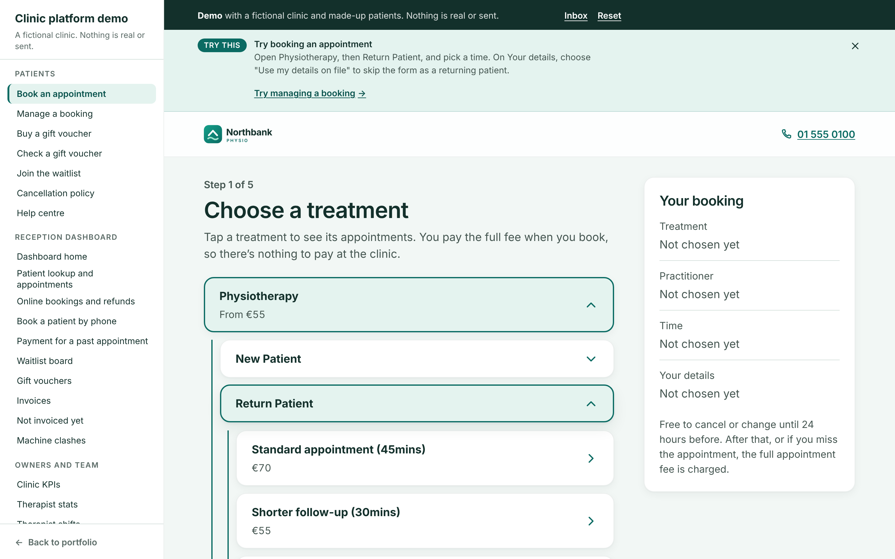
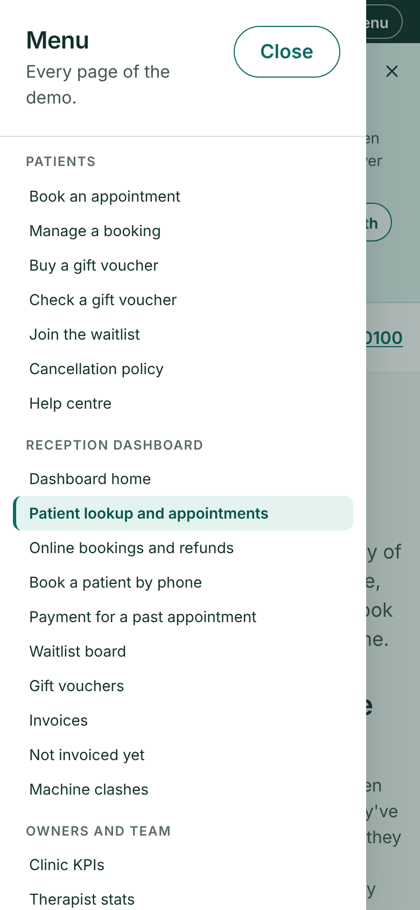
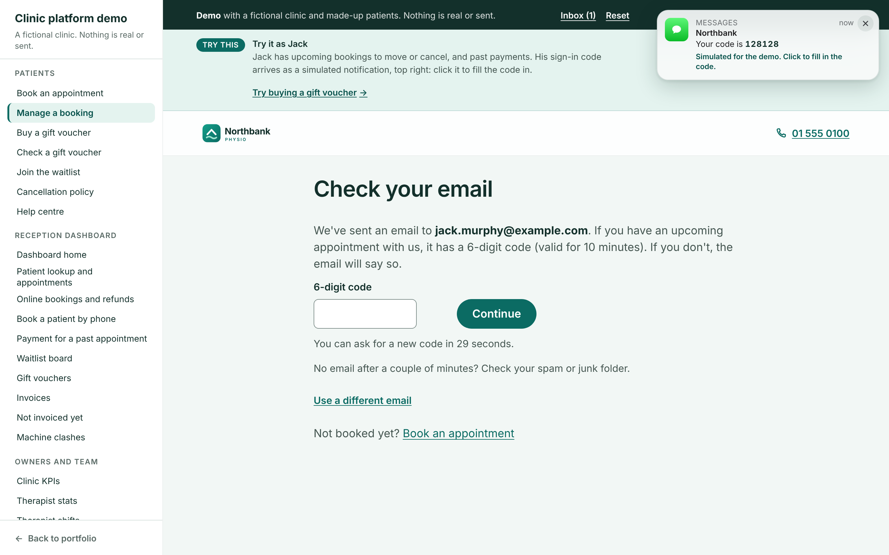
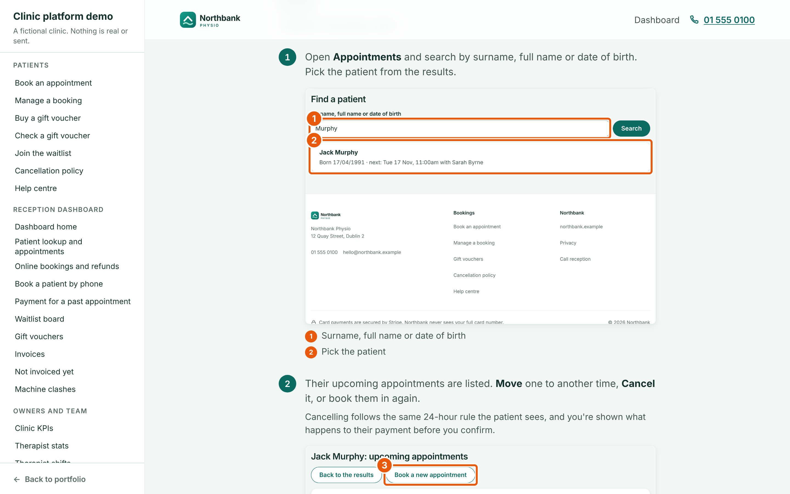

# Clinic platform demo

Online booking, payments and a reception dashboard for a physiotherapy clinic.

**[Live demo](https://cian-clinic-demo.vercel.app)** · **[Portfolio](https://cianmccaul.vercel.app)**



This is a public, working copy of a platform I built for a multi-therapist clinic in Dublin. The real system has been live since October 2026, taking bookings and payments every day. Here it runs as a **fictional clinic, Northbank Physio**, with made-up patients. It's the production interface, unchanged, with a pretend back end that runs in your browser, so there are no accounts or keys and nothing is ever charged or sent.

**[How the production system works →](docs/architecture.md)**

## Run it locally

```
npm install
npm run dev
```

Open http://localhost:3000. No instructions needed:

- **Every page is in the sidebar** (on a phone, the **Menu** button), with the page you're on highlighted, and **← Back to portfolio** at the foot.
- **A "Try this" card** under the dark demo bar says what to do on each page, with one-tap demo data (a ready email, a sample voucher code, a patient to look up) and a link to the next thing to try. Close it and it stays closed.
- **Sign-in codes arrive as a simulated phone notification**, top right. Click it to fill the code in.
- The **Inbox** in the demo bar has every email and text the clinic "sends". **Reset** starts the clinic again.

| Phone menu | Code notification | Annotated help-centre guide |
| --- | --- | --- |
|  |  |  |

### Things to try

1. **Book an appointment.** The treatment menu opens in place: Physiotherapy, then New or Return Patient, then the appointment. Pick a therapist and time.
2. **Skip the form as a returning patient.** On Your details, choose *Use my details on file* as `hannah.lynch@example.com`: her details are on file, so there's nothing to type and she pays by card. As `jack.murphy@example.com`, his saved card is used too, so he skips the card page as well.
3. **Break it on purpose.** On the pretend card page, choose *"Someone takes the time while I pay"*: you keep your payment and get a link (in the Inbox) to pick another time, or ask for a refund. Choose *"The clinic diary is down"*: you're refunded in full automatically.
4. **Manage a booking** as `jack.murphy@example.com` (one tap from the hint). Move or cancel under the 24-hour rule, and see **Past payments**: every payment, its card, an extra treatment and a refund.
5. **Buy a gift voucher**, then use its code (from the Inbox) on the Pay step of a booking, check what's left on [Check a gift voucher](http://localhost:3000/vouchers/balance), or use it at the desk on the dashboard.
6. **Run reception** from the **Dashboard**. You're signed in as an owner, so every area shows.
   - **Patient lookup and appointments**: find anyone by name or date of birth, then move or cancel their appointments.
   - **Book a patient by phone**: look the caller up (their details fill in), then send a payment link **by text** or email, or charge their saved card.
   - **Online bookings**: refunds, extras, no-show and late-cancel fees, pausing online booking and the activity log.
   - **Waitlist** (offers go out by text), **Gift vouchers** (use, undo, refund, cancel), **Payment for a past appointment**, **Invoices** and **Clinic KPIs**.
7. **Read the help centre.** Patient and staff guides, every step with a screenshot captured from this demo and numbered callouts.
8. **Look around the rest.** Machine clashes, tasks, therapist stats, shifts, emails, team and timesheets are view-only, with sample data.

## What it does

**Pay, then book, without ever losing a payment.** The time is re-checked and held while the patient pays, then re-checked again when the payment lands. If it's gone, the payment is kept and the patient picks another time with the same therapist (refunded automatically after 7 days if they don't). If the diary can't be reached, they're refunded in full. Nobody is left paid but not booked.

**Safe retries.** Payment webhooks get retried. The handler ignores an event it has already processed and looks for the appointment it already made before creating one, so a retry never double-books or double-charges.

**One cancellation policy.** The 24-hour rule and its wording live in one module, used by booking, "Manage my booking", reception and every email.

**Therapists paid directly.** Each payment is a direct charge on the therapist's own Stripe account, because they're self-employed and the money is theirs. Staff the clinic pays itself are charged on the clinic's own account.

**A booking menu in the clinic's own words.** Step 1 is dropdowns that open in place, laid out exactly as the clinic wrote its list. Every line is matched to an appointment type in the diary, so the price shown is always the price charged, a level with one choice is skipped, and a type the list doesn't mention is never hidden.

**Returning patients don't type it all again.** An emailed code proves who they are; their details come from their record and only what's missing is asked. With a saved card they skip the card page too. A family sharing one email still gets the full form, because the booking could go on the wrong record.

**Gift vouchers as a ledger.** A voucher's balance is the sum of its lines (bought, used, undone, refunded), so every change is on record. What an online booking is using is set aside while the patient pays, so it can't be spent twice, and cancelling in time puts it back.

**Texts that say nothing private.** Payment links and waitlist offers go by text to Irish mobiles: the date and a link, never the treatment, because texts show on lock screens.

**One machine, one booking.** There's one shockwave machine and one laser, so the Hub never offers a time when the machine is in use, and a dashboard page catches clashes made straight in the diary.

**Money in cents, time in Irish time.** Amounts are whole cents end to end. Every date is an Irish calendar day, including when the clocks change.

## How it works

The pages and components in `app/`, `components/` and `core/` are the production code, with the clinic's name, staff and details swapped for fictional ones. They call `/api/...` exactly as they do in production. In the demo, `demo/install.ts` answers those calls in the browser instead, from `demo/server/`, which follows the production route handlers and keeps everything in local storage. Each visitor gets their own clinic, rebuilt every day.

```
app/, components/        the production pages and components
core/                    the production business logic: pure, no I/O
  policy.ts              the 24-hour rule, its wording, money helpers
  waitlist.ts            who gets offered a time, and when
  machines.ts            shockwave and laser capacity, clash finding
  booking-menu.ts        step 1's dropdowns, built from the clinic's list
  returning-checkout.ts  returning patients: details from their record, only gaps asked
  vouchers.ts            gift voucher codes, ledger rules, what a voucher covers
  guides/                the help centre's guides; shots.ts is written by the capture script
  kpi2.ts, kpi2-report   the KPI report (it runs on the demo diary here)
  ...
lib/                     type-only stand-ins for the server modules
demo/
  install.ts             answers the pages' /api calls in the browser
  DemoBar.tsx            the demo bar, sidebar, phone Menu, Inbox and Reset
  DemoHints.tsx          the "Try this" card for each page
  DemoNotification.tsx   the simulated phone notification for sign-in codes
  nav.ts                 every page of the demo, and each page's hint
  server/
    flows.ts             pay-then-book, the webhook, rebook, refunds, cancelling
    diary.ts             stands in for Cliniko: availability, holds, appointments
    stripe.ts            stands in for Stripe: charges and refunds per account
    paylinks.ts          phone bookings and waitlist offers, by email or text
    vouchers.ts          gift vouchers: bought, emailed, used, set aside while paying
    kpis.ts              feeds the real KPI report from the demo diary
    seed.ts              a believable month of made-up data
    routes/              the /api routes: patient, reception, money, waitlist, view-only
app/demo-checkout/       the pretend Stripe page, with "simulate a problem"
scripts/guide-shots.mjs  captures every help-centre screenshot from the running demo
tests/                   the demo server end to end, plus the production unit tests for core/
docs/architecture.md     how the real system is designed
```

## Tests

```
npm test
```

179 tests in 24 files (Vitest), all passing. `tests/demo-features.test.ts` covers the features brought over from the live system: returning patients skipping the form (and a shared email not), past payments, gift vouchers bought, used online and at the desk and put back on cancelling, texts, and the demo's menu, hints and guide pictures. `tests/demo-server.test.ts` runs the flows through the API: a paid booking, a repeated webhook, a time taken mid-payment (payment kept, rebooked, or refunded after 7 days), the diary down, the 24-hour rule both ways, refund limits, phone pay links, waitlist offers and the machine rule. `tests/core/` holds the production unit tests for the shared logic (policy, waitlist, KPIs, invoices, roles and more), unchanged apart from the clinic's details.

### Help-centre screenshots

Every guide picture is captured from this demo, never from a real clinic's system, with Playwright:

```
npm run dev
npm run guide-shots
```

It walks through the demo as a patient (phone size) and as reception (desktop size), saves each screen to `public/guide-img/`, and records where each numbered callout goes in `core/guides/shots.ts`. The callouts are drawn over the pictures when a guide is shown, so they stay sharp at any size.

## Built with

Next.js 14, React 18, TypeScript and plain CSS with design tokens. The production system also uses Stripe Connect, the Cliniko API, Upstash Redis, Postgres, Better Auth with passkeys, Resend and Twilio. See [docs/architecture.md](docs/architecture.md).

---

Built by [Cian McCaul](https://github.com/cianmccaul).
